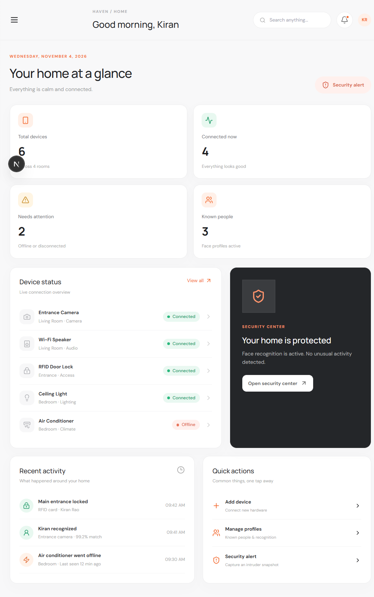

# Haven — Smart Home IoT Dashboard

Haven is a responsive smart-home IoT dashboard for monitoring and demonstrating a connected home. It provides a unified interface for reviewing device connectivity, filtering devices by room, managing household profiles, monitoring entrance security, and interacting with connected hardware.

The project started as a frontend-only Next.js prototype and has subsequently been extended with ESP32-CAM integration, Python-based face detection and recognition, and local SQLite storage.

---

## 1. Project Overview

**Website name:** Haven — Smart Home IoT Dashboard

**Purpose:** Provide a centralized dashboard for smart-home monitoring, device management, household profiles, and security monitoring.

The project combines:
- A Next.js web dashboard.
- An ESP32-CAM AI Thinker camera.
- A Python computer-vision backend.
- YuNet face detection.
- SFace face recognition.
- SQLite storage for registered people and face embeddings.

## 2. Technical Details

| Area | Technology / Details |
|---|---|
| Frontend framework | Next.js 15.2.4 |
| Routing | Next.js App Router |
| Language | TypeScript 5.7 |
| UI | React 19 |
| Styling | Tailwind CSS 3.4 and custom CSS |
| Icons | lucide-react |
| Frontend rendering | Client-side interactive page with React state |
| Backend | Python, FastAPI |
| Computer vision | OpenCV |
| Face detection | YuNet ONNX model |
| Face recognition | SFace ONNX model |
| Numerical processing | NumPy |
| Database | SQLite |
| Hardware | ESP32-CAM AI Thinker with OV2640 |
| Communication | HTTP and MJPEG streaming |
| Recognition processing | Local CPU inference |
| Frontend development server | `http://localhost:3000` |
| Backend API | `http://127.0.0.1:8000` |

## 3. System Architecture

```text
                  ESP32-CAM
                AI Thinker
                    |
                    | MJPEG over HTTP
                    v
             Python FastAPI Backend
                    |
             +------+------+
             |             |
             v             v
        YuNet Detector   SFace Recognizer
             |             |
             +------+------+
                    |
                    v
           Face Embedding Matching
                    |
                    v
              SQLite Database
                    |
                    v
          Annotated MJPEG Stream
                    |
                    v
             Next.js Frontend
                    |
                    v
             Haven Dashboard
```

The ESP32-CAM captures and transmits video. The Python backend performs face detection and recognition on the computer's CPU. The frontend displays the processed video and provides the dashboard interface.

The Python backend and Next.js frontend are intended to run on the same computer in the current configuration.

## 4. Main Website Pages and Functions

### Authentication Screen
- Demo sign-in and account creation forms.
- Demonstrates the authentication flow.
- Does not currently authenticate against a production identity service.

### Overview
- Total device count.
- Connected device count.
- Devices requiring attention.
- Household profile information.
- Security status.
- Recent activity.
- Quick actions.

Some overview values and activity entries remain demonstration data.

### Devices
- Searchable device list.
- Room-based filters.
- Device status indicators.
- Local on/off state changes.
- Add-device form.

Device controls currently use local UI state unless connected to a corresponding hardware service.

### People
- Register household members.
- Upload 3–5 photographs for a person.
- Detect and align faces during enrollment.
- Generate SFace embeddings.
- Store registered identities and embeddings in SQLite.
- Retrieve registered profiles from the backend.
- Delete profiles and associated face embeddings.

Original uploaded photographs are not retained by the current enrollment API.

### Security
- ESP32-CAM entrance monitoring.
- Live MJPEG video stream.
- YuNet face detection.
- SFace-based identity matching against enrolled profiles.
- Green bounding boxes for recognized identities.
- Red bounding boxes for unknown identities.
- Similarity scores displayed with recognition results.

Face recognition is an experimental feature and should not be treated as a standalone access-control mechanism.

### Audio Controls
- Demonstration Wi-Fi speaker controls.
- Play and pause.
- Volume adjustment.
- Track selection.

The audio controls remain demo functionality until connected to the audio ESP32 or an appropriate backend/MQTT service.

## 5. Face Recognition Pipeline

The face-recognition subsystem uses two ONNX models.

| Model | Responsibility |
|---|---|
| YuNet | Face detection and facial landmark localization |
| SFace | Face alignment and embedding extraction |

### Enrollment

1. A user enters a person's name in the People page.
2. The user selects 3–5 photographs.
3. YuNet detects the face in each photograph.
4. The system rejects images with no face or multiple faces.
5. SFace aligns the detected face and generates an embedding.
6. The embeddings and associated person ID are stored in SQLite.

### Live Recognition

1. The Python backend reads frames from the ESP32-CAM.
2. YuNet detects faces in each frame.
3. SFace extracts embeddings for the detected faces.
4. The embeddings are compared with enrolled face representations using cosine similarity.
5. A matching identity is displayed when the configured threshold is met.
6. Otherwise, the face is labelled Unknown.
7. The annotated frame is streamed to the Next.js dashboard.

The current recognition threshold is configurable through the backend environment file. Its initial value is 0.40 and must be calibrated using real camera data.

## 6. Project Structure

```text
smart-home-iot-dashboard/
│
├── app/
│   ├── page.tsx
│   ├── layout.tsx
│   └── globals.css
│
├── components/
│   └── ESP32Camera.tsx
│
├── backend/
│   ├── models/
│   │   ├── face_detection_yunet_2023mar.onnx
│   │   └── face_recognition_sface_2021dec.onnx
│   │
│   ├── main.py
│   ├── face_engine.py
│   ├── database.py
│   ├── requirements.txt
│   ├── .env.example
│   └── README.md
│
├── public/
│   └── haven-dashboard.png
│
├── .env.example
├── .gitignore
├── package.json
├── package-lock.json
├── tailwind.config.ts
└── README.md
```

The SQLite database (`backend/haven.db`) is created automatically when the backend starts. It is local runtime data and is not included in the repository.

The Python virtual environment and Node.js dependencies are also created locally rather than committed.

## 7. Requirements

- Windows 10 or Windows 11.
- Git.
- Node.js (LTS).
- Python 3.11.
- ESP32-CAM AI Thinker with OV2640 camera.
- ESP32-CAM firmware already flashed.
- Computer and ESP32-CAM connected to a network that allows communication between them.

**Arduino IDE is not required for normal application operation.** It is only needed, or replaceable with another firmware development tool, when flashing or modifying the ESP32-CAM firmware.

## 8. Installation and Setup

### Step 1 — Clone the repository

```bash
git clone YOUR_REPOSITORY_URL
cd smart-home-iot-dashboard
```

### Step 2 — Configure the frontend

Copy the frontend environment template:

```cmd
copy .env.example .env.local
```

The root `.env.example` should contain:

```env
NEXT_PUBLIC_HAVEN_API_URL=http://127.0.0.1:8000
```

### Step 3 — Install frontend dependencies

```bash
npm ci
```

### Step 4 — Configure the Python backend

Copy the backend environment template:

```cmd
copy backend\.env.example backend\.env
```

Edit `backend/.env` and configure the ESP32-CAM address:

```env
ESP32_STREAM_URL=http://YOUR_ESP32_IP:81/stream
RECOGNITION_THRESHOLD=0.40
```

Replace `YOUR_ESP32_IP` with the camera's actual local IP address.

### Step 5 — Create the Python environment

```cmd
cd backend

py -3.11 -m venv venv

venv\Scripts\activate.bat

python -m pip install --upgrade pip

pip install -r requirements.txt
```

The virtual environment is created locally. It is not downloaded from GitHub.

### Step 6 — Verify the ONNX models

Ensure the following files exist:

```text
backend/models/
    face_detection_yunet_2023mar.onnx
    face_recognition_sface_2021dec.onnx
```

These models are required for the face-detection and recognition pipeline.

### Step 7 — Start the Python backend

From the `backend` directory:

```cmd
venv\Scripts\activate.bat
python main.py
```

Backend address:

`http://127.0.0.1:8000`

Interactive API documentation:

`http://127.0.0.1:8000/docs`

### Step 8 — Start the Next.js frontend

Open a second terminal in the project root:

```bash
npm run dev
```

Open:

`http://localhost:3000`

## 9. Environment Configuration

Environment templates are committed to GitHub. Actual environment files are created locally by each developer.

| File | Commit to GitHub? | Purpose |
|---|---|---|
| `.env.example` | Yes | Frontend configuration template |
| `.env.local` | No | Local frontend configuration |
| `backend/.env.example` | Yes | Backend configuration template |
| `backend/.env` | No | Local backend configuration |

Never commit personal credentials, Wi-Fi passwords, or other secrets.

The ESP32-CAM IP address is network-specific. Each developer must configure the address of their own camera.

## 10. API Endpoints

| Method | Endpoint | Purpose |
|---|---|---|
| GET | `/` | Backend health overview |
| GET | `/health` | Check loaded models and backend status |
| GET | `/camera/status` | Camera and recognition status |
| GET | `/camera/stream` | Annotated live MJPEG stream |
| POST | `/people/enroll` | Enroll a person using photographs |
| GET | `/people` | Retrieve enrolled profiles |
| DELETE | `/people/{person_id}` | Delete a person and associated embeddings |

The raw ESP32-CAM stream is separate from the processed Python stream.

Raw camera stream:

`http://YOUR_ESP32_IP:81/stream`

Processed recognition stream:

`http://127.0.0.1:8000/camera/stream`

The Haven frontend should display the processed Python stream.

## 11. Data Storage and Privacy

The current backend uses local SQLite storage.

- Person names and registration timestamps are stored in the `people` table.
- Face embeddings are stored in the `face_samples` table.
- Multiple face samples can be associated with one person.
- Deleting a person also deletes associated face samples.
- Original uploaded enrollment photographs are not retained by the current enrollment endpoint.

Face embeddings are biometric data. Enroll people only with their consent, protect the local database, and provide a way to delete their profiles.

Face recognition can produce false matches and must not be used as the sole basis for granting physical access.

## 12. GitHub and Reproducibility

The repository includes the application source, Python source files, dependency manifests, environment templates, and required ONNX models, subject to their distribution licences.

The following should not be committed:

```text
node_modules/
.next/
backend/venv/
backend/haven.db
backend/.env
.env.local
__pycache__/
*.pyc
```

A new developer recreates the Node.js and Python environments using the installation instructions above.

## 13. Current Limitations and Integration Points

The project is partially integrated. Implemented functionality and demonstration functionality should be distinguished.

| Feature | Current status |
|---|---|
| Next.js dashboard | Implemented |
| Responsive sidebar and room filters | Implemented |
| Device summary cards | Implemented with demo data |
| Local device on/off toggles | Implemented as UI state |
| ESP32-CAM video streaming | Integrated |
| YuNet live face detection | Integrated |
| SFace identity matching | Integrated; requires calibration |
| People enrollment | Integrated |
| SQLite profile storage | Integrated |
| Security event history | Further integration required |
| Audio controls | Demonstration UI |
| RFID access integration | Further integration required |
| MQTT device monitoring | Further integration required |
| Production authentication | Not implemented |
| Secure remote access gateway | Not implemented |

### Later Integration Points

- Connect audio controls to the audio ESP32 or an MQTT/backend service.
- Replace sample device data with real API/MQTT readings.
- Integrate RFID access events with the security dashboard.
- Add persistent security event history and duplicate-event suppression.
- Improve face-recognition calibration and evaluation under different lighting conditions.
- Implement production authentication and authorization.
- Route remote access through a secured backend gateway instead of exposing ESP32 devices directly to the public Internet.

## 14. Website Screenshot

The following screenshot shows the original authenticated dashboard overview using the included sample data:



## 15. Source Code

- [Dashboard page and interactions](./app/page.tsx)
- [Global layout and metadata](./app/layout.tsx)
- [Responsive visual styling](./app/globals.css)
- [Tailwind configuration](./tailwind.config.ts)
- [Dependency and script configuration](./package.json)
- [Python backend](./backend/main.py)
- [Face-processing engine](./backend/face_engine.py)
- [SQLite database operations](./backend/database.py)

---

**Haven — Smart Home IoT Dashboard**

A Next.js-based smart-home dashboard extended with ESP32-CAM monitoring, local computer-vision processing, and face-recognition capabilities.
